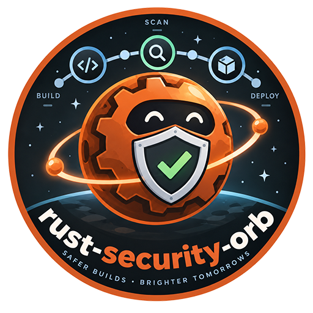
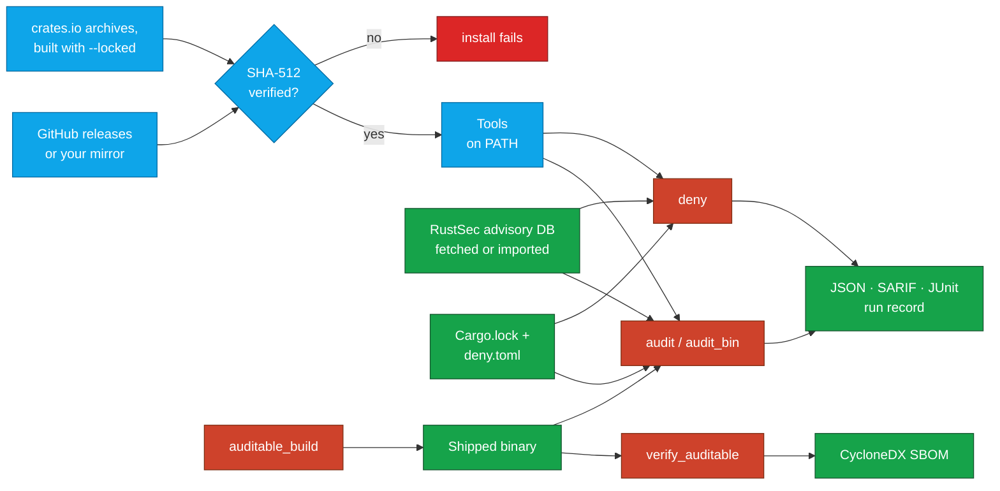

<div align="center">



# Rust Security Orb for CircleCI

### Check Rust dependencies and shipped binaries against RustSec, your policy and your supply chain, straight from CircleCI.

Install checksum-verified [cargo-audit](https://github.com/rustsec/rustsec/tree/main/cargo-audit), [cargo-deny](https://github.com/EmbarkStudios/cargo-deny), [cargo-auditable](https://github.com/rust-secure-code/cargo-auditable) and friends, and gate builds on what they find:<br>
advisories, licences, banned crates and sources, the dependency list embedded in each binary you ship, SBOMs and supply-chain audits.<br>
Your tools' own configs are the policy · SARIF, JUnit and run records · Works offline · Strict SHA-512 verification by default · No `sudo`

[](https://circleci.com/gh/juburr/rust-security-orb)
[](https://circleci.com/developer/orbs/orb/juburr/rust-security-orb)
[](LICENSE)
[](https://discuss.circleci.com/c/ecosystem/orbs)


**[Quick Start](#-quick-start)** · **[Features](#-why-rust-security-orb)** · **[Recipes](#-recipes)** · **[Commands](#-commands)** · **[Reports](#-reports-and-evidence)** · **[Security](#-secure-by-design)** · **[Network Access](#-network-access)**

<sub>An unofficial, community-maintained orb. [Contributions are welcome!](#-contributing)</sub>

</div>

<br>

## ✨ Why rust-security-orb?

<table>
<tr>
<td width="33%" valign="top">
🛡️ <b>Advisories, licences, bans, sources</b><br><br>
<code>audit</code> checks <code>Cargo.lock</code> against the RustSec advisory database, and <code>deny</code> runs every cargo-deny check against your <code>deny.toml</code>. Findings fail the step with each tool's own exit semantics; <code>report_only</code> reports them instead.
</td>
<td width="33%" valign="top">
📦 <b>Check what you ship</b><br><br>
<code>auditable_build</code> embeds each binary's resolved dependency list, <code>verify_auditable</code> proves it survived stripping and packaging, and <code>audit_bin</code> checks the binary itself, not a lockfile that covers every feature set and target at once.
</td>
<td width="33%" valign="top">
📜 <b>Your configs are the policy</b><br><br>
<code>deny.toml</code>, <code>.cargo/audit.toml</code> and <code>supply-chain/</code> stay where they are, with the meaning they already have. The orb adds no exception file of its own, and <code>require_ignore_reasons</code> holds every ignore in <code>deny.toml</code> to having a reason.
</td>
</tr>
<tr>
<td width="33%" valign="top">
🧾 <b>Reports and evidence</b><br><br>
Each tool's native JSON and SARIF 2.1.0, JUnit for CircleCI's Tests tab, CycloneDX SBOMs, a licence inventory, and a run record per check: tool checksums, database commit, lockfile hash, arguments and counts.
</td>
<td width="33%" valign="top">
✈️ <b>Offline and air-gapped</b><br><br>
Fetch the advisory database once per workflow, or import a copy you staged, and check without network access. A database too old to trust fails the step unless you say otherwise. Installs can come from your own mirror.
</td>
<td width="33%" valign="top">
🔐 <b>Verified tools, amd64 and arm64</b><br><br>
Every tool is checked against a SHA-512 this orb pins: release binaries for x86_64 and Arm, and verified crate archives built with <code>cargo install --locked</code> where upstream ships none. Versions it can't verify are refused.
</td>
</tr>
</table>

### 🧩 The Orb vs. a Hand-Rolled Script

| | Scripting it yourself | With the orb |
| --- | --- | --- |
| **Installing the tools** | `cargo install` each one on every run (minutes each), or download a release and trust it | `rust-security/install` downloads release binaries, or builds verified crate archives, checks each against a pinned SHA-512, caches them and puts them on the `PATH` |
| **Telling findings from failures** | cargo-audit exits 1 for both; cargo-deny's exit code is a bitmask of failed checks; cargo-vet exits 255 for both | Each command reads the tool's report: findings fail unless `report_only` is true, and a tool that couldn't run always fails the step |
| **One advisory database** | Each tool fetches its own copy, at its own time, into its own directory | `fetch_advisory_db` puts one copy where both tools read it, to persist and import in later jobs, with its commit in every run record |
| **SARIF and JUnit** | cargo-deny's SARIF exits 0 whatever it finds; JUnit means writing a converter | Every reporting command writes SARIF (where the tool can), JUnit on request, and stores both |
| **Shipped binaries** | Hope the lockfile matches what the binary links, and that strip kept the audit data | `verify_auditable` reads the data back from the final file, and `audit_bin` checks that file |

## 🔄 How It Works



`rust-security/install` downloads each tool's release for the executor's architecture (or, for the tools that publish no binaries, the crate's source archive) and installs it only if it matches the SHA-512 this orb pins for that version, in the default `strict` mode. `fetch_advisory_db` puts the RustSec advisory database where cargo-deny reads it and exports its path for cargo-audit. `audit` and `deny` check the lockfile and the dependency graph against it and your configs, and each writes the tool's JSON, SARIF and, on request, JUnit and a run record to `output_dir`, which is stored as job artifacts even when the step fails. `auditable_build` builds binaries that carry their dependency list, `verify_auditable` checks that the shipped files still do and turns it into an SBOM, and `audit_bin` audits them.

## 🚀 Quick Start

Add the orb, install the tools, check the project. Copy this into `.circleci/config.yml`:

```yaml
version: 2.1

orbs:
  rust-security: juburr/rust-security-orb@0.1.0

jobs:
  security:
    docker:
      - image: cimg/rust:1.99
    steps:
      - checkout
      # cargo-audit, cargo-deny and cargo-auditable, verified.
      - rust-security/install
      - rust-security/fetch_advisory_db
      - rust-security/audit:
          no_fetch: true
          junit: true
      - rust-security/deny:
          junit: true

workflows:
  security:
    jobs:
      - security
```

`fetch_advisory_db` fetches the RustSec advisory database once, `audit` checks `Cargo.lock` against that copy, and `deny` runs cargo-deny's advisories, bans, licences and sources checks against your `deny.toml`. Each fails the job on what it finds, and stores its reports under `rust-security-reports/` in the job's artifacts, with JUnit in the Tests tab.

`deny` needs a `deny.toml` in the project, since cargo-deny's default config allows no licence at all. `cargo deny init` writes one with every option documented; start from that, list the licences you accept, and set `[graph] targets` to the targets you ship (see [Check Every Shipped Configuration](#check-every-shipped-configuration)).

> [!IMPORTANT]
> This orb is at 0.x, so a minor release may still change a command or parameter. Pin the orb version so it only changes when you decide. Each tool's version is pinned by the install command's defaults, so it changes only with the orb.

## 🍳 Recipes

### Adopt the Checks Gradually

A project with findings it hasn't triaged yet can see them without failing builds:

```yaml
- rust-security/deny:
    report_only: true
```

With `report_only`, findings are printed, written to every report and marked `findings-reported` in the run record, and the step passes with a warning. A tool that can't run at all, such as cargo-deny with a `deny.toml` it can't parse, still fails the step: no report is not a clean report. Turn `report_only` off once the findings are fixed or justified in `deny.toml`.

### Check Every Shipped Configuration

Rust resolves a different dependency graph for each feature set and target, so check the graph you ship, not the default build. Run the same job once per shipped configuration with a matrix:

```yaml
jobs:
  deny:
    parameters:
      features:
        type: string
      target:
        type: string
    docker:
      - image: cimg/rust:1.99
    steps:
      - checkout
      - rust-security/install:
          tools: cargo-deny
      - rust-security/deny:
          no_default_features: true
          features: << parameters.features >>
          target: << parameters.target >>
          report_name: deny-<< parameters.features >>-<< parameters.target >>

workflows:
  security:
    jobs:
      - deny:
          matrix:
            parameters:
              features: ["tls-rustls", "tls-openssl"]
              target: ["x86_64-unknown-linux-gnu", "aarch64-unknown-linux-gnu"]
```

- **Bans are a boundary statement per configuration.** Two backends that must never ship in the same binary can't be expressed in one `deny.toml`, but they can be one config each: the rustls build's config bans `openssl-sys`, and the OpenSSL build's bans `rustls`. Give each configuration its own `config_path`, and a build that pulls in the other backend fails its bans check.
- **Limit the graph to the targets you build.** By default cargo-deny checks every crate Cargo resolves, including dependencies only Windows or Fuchsia would use, so an advisory against one fails a Linux-only product. List what you ship in `deny.toml`:

  ```toml
  [graph]
  targets = ["x86_64-unknown-linux-gnu", "aarch64-unknown-linux-gnu"]
  ```

- **Mind workspace feature unification.** Cargo unifies features across everything one `cargo build` builds. A crate checked on its own (`cargo build -p app`) can have a cleaner graph than the same crate in a workspace-wide release build, which links the union of every member's features. Check the resolution your release build performs: `workspace: true` checks every member together, and `exclude` leaves out members you don't ship.
- **A lockfile is a superset.** `Cargo.lock` lists the crates of every configuration at once. For anything you distribute, also audit the binary itself (next recipe).

### Audit What You Ship

Build with cargo auditable, check the final file after stripping and packaging, and audit that file:

```yaml
steps:
  - checkout
  - rust-security/install:
      tools: cargo-audit cargo-auditable rust-audit-info auditable2cdx
  - rust-security/fetch_advisory_db
  - rust-security/auditable_build:
      extra_args: --release --locked
  - run:
      name: Package
      command: |
        mkdir -p dist
        cp target/release/myapp dist/
        strip dist/myapp
  - rust-security/verify_auditable:
      binaries: dist/myapp
      cyclonedx: true
  - rust-security/audit_bin:
      binaries: dist/*
      require_auditable: true
      no_fetch: true
```

cargo auditable embeds the resolved dependency list in a `.dep-v0` section of each binary it links, at a cost of a few kilobytes. GNU `strip` keeps it; `llvm-strip`, `strip --strip-section-headers` and some packers remove it without a word, which is why `verify_auditable` reads it back from the file you ship and fails when it is gone. With `cyclonedx`, it also writes a CycloneDX SBOM of exactly what that binary links. `audit_bin` then checks each binary against the advisory database: a binary built without the vulnerable feature passes even when the lockfile lists the crate.

### Fetch the Advisory Database Once per Workflow

Fetch the database in one job, persist it, and have every later job check against that very copy:

```yaml
jobs:
  fetch-advisories:
    docker:
      - image: cimg/rust:1.99
    steps:
      - rust-security/fetch_advisory_db:
          archive: /tmp/workspace/advisory-db.tar.gz
      - persist_to_workspace:
          root: /tmp/workspace
          paths: [advisory-db.tar.gz]
  check:
    docker:
      - image: cimg/rust:1.99
    steps:
      - checkout
      - attach_workspace:
          at: /tmp/workspace
      - rust-security/install
      - rust-security/fetch_advisory_db:
          import: /tmp/workspace/advisory-db.tar.gz
      - rust-security/audit:
          no_fetch: true
      - run:
          name: Fetch Dependencies
          command: cargo fetch --locked
      - rust-security/deny:
          offline: true
```

The database lands where cargo-deny looks without configuration (`$CARGO_HOME/advisory-dbs/<name>-<hash of the URL>`), and `RUSTSEC_ADVISORY_DB` points `audit` and `audit_bin` at the same directory. `no_fetch` stops cargo-audit from updating it. cargo-deny 0.20 has no option that skips only the database fetch, so `offline` keeps it from updating the copy, and `cargo fetch` beforehand gives its `cargo metadata` the crates it then can't download. The archive keeps the git history, so the database's age is known wherever it is imported.

### Run Without Network Access

On a runner that can't reach the internet, every input has to be staged:

1. **Tools**: install from an internal mirror of GitHub releases with `download_base_url` (an Artifactory or Nexus remote repository of `https://github.com`). What the mirror serves is still checked against the orb's checksums. The three tools built from source need crates.io, or a [source replacement](https://doc.rust-lang.org/cargo/reference/source-replacement.html) for it in `.cargo/config.toml`; install them where the network is available and keep them in the cache, or skip them.
2. **Advisory database**: `fetch_advisory_db` with `import` pointing at a copy you staged: a git checkout of the database, or an `archive` written by an earlier `fetch_advisory_db`. A private mirror of the database works for `url` too, with `auth_header_env_var` naming the variable that holds its `Authorization` header.
3. **Checks**: `audit` and `audit_bin` with `no_fetch: true` and `no_yanked: true` (the yanked check queries the crates.io index), and `deny` and `licenses` with `offline: true` and `metadata_path` pointing at the output of `cargo metadata --format-version 1 --locked`, generated where the network was available.

Both tools refuse a database that is too old to trust when they can't fetch: `audit` fails when its newest commit is 90 days old or more, unless `allow_stale` is true, and cargo-deny fails past `deny.toml`'s `maximum-db-staleness` (90 days by default). Refresh the staged copy on a schedule rather than turning these off. The orb's CI runs exactly this with `github.com` and crates.io blocked, on a machine with no Rust toolchain.

Behind a proxy instead, set `HTTPS_PROXY` (and `NO_PROXY`) for the job: curl, git, cargo and both tools honour it. Cargo's own settings, such as `CARGO_HTTP_PROXY` and `CARGO_NET_GIT_FETCH_WITH_CLI`, apply to everything that runs cargo.

### Keep Exceptions Reviewed

The orb adds no exception file. Each tool already has one:

- **`deny.toml`** takes a reason with each ignore, and is the recommended home for reviewed exceptions, since the reason travels with the entry:

  ```toml
  [advisories]
  ignore = [
      { id = "RUSTSEC-2021-0003", reason = "SmallVec::insert_many is never called; upgrade tracked in ISSUE-123" },
  ]
  ```

  With `require_ignore_reasons: true`, `deny` fails when an ignore that applied has no reason, and lists it. It reads cargo-deny's own report of the ignores it applied, so only entries that matched an advisory count.
- **`.cargo/audit.toml`** takes bare advisory IDs under `[advisories] ignore`, with no field for a reason. Teams that need justified exceptions should keep them in `deny.toml` and run `deny`'s advisories check, or keep a comment above each entry by convention.

Neither tool has expiry dates for exceptions, so the orb doesn't invent one: a field only this orb understood would tie every adopter to it.

### Keep Evidence for an Assessor

`run_record: true` writes `<report_name>.run-record.json` next to the reports: what ran (the tool's path, version, SHA-512 and how the orb installed it, and the same for auditable2cdx and rust-audit-info when `verify_auditable` and `audit_bin` run them as well), on what (the lockfile's and configs' SHA-256, the advisory database's URL, commit and commit time, the arguments, which carry the feature set, target and workspace selection), with what result (the outcome, the tool's exit code, counts by check and severity) and what it wrote (each report's SHA-256). It follows [`schemas/run-record.v1.json`](schemas/run-record.v1.json). Store it with the release, or attest it to the image or binary it describes with [cosign-orb](https://github.com/juburr/cosign-orb)'s `attest`, so the answer to "what exactly was checked?" doesn't depend on rerunning the job.

### Inventory Licences for Legal Review

```yaml
- rust-security/licenses:
    all_features: true
```

`licenses` writes every crate in the graph with its licences, as `licenses.json` and `licenses.tsv` (a crate-by-licence matrix that opens in a spreadsheet). It never fails on what it finds; the pass/fail licence check is `deny`'s, against `deny.toml`. Inventory the feature set and target you ship, or `all_features` for everything a release could link.

## 🧰 Commands

Run `install` before the other commands in the same job. Each reporting command writes to `output_dir` (default `/tmp/rust-security-reports`) and stores it as job artifacts under `rust-security-reports/`, even when the step fails. Give each run in a job its own `report_name`, so they don't overwrite each other's reports.

### `rust-security/install`

Installs the tools named in `tools`, each verified against the orb's checksum table, through that tool's own install command (below). cargo-audit, cargo-deny, cargo-auditable and cargo-cyclonedx publish Linux binaries, downloaded for amd64 or arm64 from `uname -m`. cargo-vet, rust-audit-info and auditable2cdx publish none for current releases, so their crate archives are verified and built with `cargo install --locked`, which needs cargo and takes a few minutes; the install record then says `source-built`.

| Parameter | Default | Description |
| --- | --- | --- |
| `tools` | `cargo-audit,cargo-deny,cargo-auditable` | The tools to install, separated by commas or spaces: `cargo-audit`, `cargo-deny`, `cargo-auditable`, `cargo-cyclonedx`, `cargo-vet`, `rust-audit-info`, `auditable2cdx`. An unknown name fails the step. |
| `cargo_audit_version`, `cargo_deny_version`, `cargo_auditable_version`, `cargo_cyclonedx_version`, `cargo_vet_version`, `rust_audit_info_version`, `auditable2cdx_version` | `0.22.2`, `0.20.2`, `0.7.7`, `0.5.9`, `0.10.2`, `0.5.4`, `0.1.0` | Each tool's version, used when `tools` names it. |
| `install_path` | `$HOME/bin` | Absolute path of the directory to install into, writable without root. Created if needed, and added to `PATH` for later steps when it isn't already on it. |
| `verify_checksums` | `strict` | `strict`, `known_versions` or `false`, for every tool. See [Checksum Verification](#-checksum-verification). |
| `caching` | `true` | Cache each tool's verified download between jobs, keyed by tool, version, CPU architecture and home directory. A cached file is verified again before it is used. For the tools built from source, the archive is cached and built in each job. |
| `download_base_url` | *(empty)* | An `https://` mirror of GitHub releases to download the prebuilt tools from, in place of `https://github.com`, serving the same paths. What it serves is still verified. Credentials in the URL (`user:password@`) are refused, since they would show in the log. |

### `rust-security/install_<tool>`

`install_cargo_audit`, `install_cargo_deny`, `install_cargo_auditable`, `install_cargo_cyclonedx`, `install_cargo_vet`, `install_rust_audit_info` and `install_auditable2cdx` install one tool each, as `install` does, and take `version`, `install_path`, `verify_checksums` and `caching` with the same meaning (the four prebuilt tools also take `download_base_url`). Use one to install a tool at a version of its own, or in a job that needs only that tool.

Each leaves `.<tool>.install.json` next to the binary, naming the version, the verified asset, its SHA-512, the method (`prebuilt` or `source-built`) and the binary's SHA-512. The other commands read it: when the tool they find first on the `PATH` isn't the binary an install command verified, such as a copy that came with the image, they warn, and its run record has no install record.

### `rust-security/fetch_advisory_db`

Fetches the RustSec advisory database (a shallow git clone), or imports a copy staged earlier, into the directory cargo-deny reads by default, and exports `RUSTSEC_ADVISORY_DB` for `audit` and `audit_bin`. Whether fetched or imported, the copy is dated by its newest commit, so both tools judge its age the same way. Needs git.

| Parameter | Default | Description |
| --- | --- | --- |
| `url` | `https://github.com/RustSec/advisory-db` | The database's git repository, or an internal mirror of it, over `https`, with a path of plain ASCII and no `.` or `..` segments. Use the URL `deny.toml`'s `db-urls` names, if it names one: cargo-deny's directory is named after it. A database whose newest commit is dated in the future fails the step, since neither tool could tell it is stale. |
| `import` | *(empty)* | Import instead of fetching: a directory holding the database's git checkout, or a `.tar.gz` that `archive` wrote. Needs no network access. |
| `db_dir` | `$CARGO_HOME/advisory-dbs` | Where to put the database, under its URL-derived name. cargo-deny reads another directory only if `deny.toml`'s `db-path` names it. |
| `archive` | *(empty)* | Also write the database, git history included, to this `.tar.gz`, to persist to the workspace or store. |
| `auth_header_env_var` | *(empty)* | *Name* of the environment variable holding an `Authorization` header value (`Bearer <token>` or `Basic <base64>`) for a private mirror. It reaches git through its environment, never its command line, and is never printed. |

### `rust-security/audit`

Checks a `Cargo.lock` with `cargo audit`. Fails on vulnerabilities, and on the warning kinds `deny` (or the `[output] deny` list in `.cargo/audit.toml`) denies, unless `report_only` is true. Always fails when cargo audit can't complete, exits non-zero without reporting anything, or can't check for yanked crates while `deny` covers them (it only warns otherwise), and when the lockfile lists no packages (cargo audit takes any TOML file without a package list for an empty lockfile, and passes it). cargo audit reads its policy, such as ignores, from `.cargo/audit.toml` in `working_dir` or `$CARGO_HOME/audit.toml`.

| Parameter | Default | Description |
| --- | --- | --- |
| `working_dir` | `.` | Directory to run in. |
| `lockfile` | `Cargo.lock` | The lockfile to audit. It must exist: the step fails rather than let cargo audit generate one. |
| `db_path` | *(empty)* | The advisory database. Defaults to the one `fetch_advisory_db` exported, or else cargo audit's own, `$CARGO_HOME/advisory-db`. |
| `no_fetch` | `false` | Use the database without updating it. cargo audit checks a database's age only when it fetches, so `audit` then applies cargo audit's 90-day rule itself, as it does when `.cargo/audit.toml` sets `[database] fetch = false`. |
| `allow_stale` | `false` | Accept a database whose newest commit is 90 days old or more. |
| `deny` | *(empty)* | Warning kinds that fail like vulnerabilities: `unmaintained`, `unsound`, `yanked`, or `warnings` for all three. |
| `target_arch`, `target_os` | *(empty)* | Report only vulnerabilities that affect these architectures or operating systems, such as `x86_64` and `linux`. |
| `no_yanked` | `false` | Skip the yanked-crate check, which queries the crates.io index (cargo-audit 0.22.2 and later). |
| `extra_args` | *(empty)* | More `cargo audit` arguments, split like shell words; nothing in them is run as shell code. `--json` and `--format` are refused. |
| `output_dir`, `report_name`, `sarif`, `junit`, `report_only`, `run_record`, `store_artifacts` | | See [Reports and Evidence](#-reports-and-evidence). `report_name` defaults to `cargo-audit`. |

### `rust-security/audit_bin`

Checks built binaries with `cargo audit bin`, which reads the dependency list cargo auditable embedded in each. Each binary is audited on its own, with its own JSON and SARIF report (`<report_name>-<binary>.json`), listed in an index, `<report_name>.json`, with each binary's SHA-256. A binary cargo audit can't read fails the step even with `report_only`.

| Parameter | Default | Description |
| --- | --- | --- |
| `binaries` | *required* | The binaries to audit, separated by spaces or commas. Shell patterns such as `dist/*` are expanded, and everything they match must be a binary (`target/release/*` also matches directories and `.d` files); a pattern that matches nothing fails the step. Name the files you ship, after stripping and packaging. |
| `require_auditable` | `false` | Count a binary without cargo-auditable data as a finding: without it, cargo audit can only guess a binary's dependencies from its panic messages. Needs rust-audit-info. |
| `working_dir`, `db_path`, `no_fetch`, `allow_stale`, `deny`, `target_arch`, `target_os`, `no_yanked`, `extra_args` | | As for `audit`. |
| `output_dir`, `report_name`, `sarif`, `junit`, `report_only`, `run_record`, `store_artifacts` | | See [Reports and Evidence](#-reports-and-evidence). `report_name` defaults to `cargo-audit-bin`. |

### `rust-security/deny`

Runs `cargo deny check` against the project's `deny.toml`: advisories, bans, licences and sources. Fails when a check finds errors, as `deny.toml` configures them, unless `report_only` is true; always fails when cargo deny can't complete, such as with a `deny.toml` it can't parse or a database older than `maximum-db-staleness` it may not fetch. Needs cargo-deny 0.20.0 or later.

| Parameter | Default | Description |
| --- | --- | --- |
| `checks` | *(all four)* | The checks to run, separated by commas or spaces: `advisories`, `bans`, `licenses`, `sources`. |
| `config_path` | *(empty)* | The config to use. Defaults to the first `deny.toml`, `.deny.toml` or `.cargo/deny.toml` in the manifest's directory or above. A path that doesn't exist fails the step, where cargo deny would fall back to its default config. |
| `manifest_path` | *(empty)* | The `Cargo.toml` to check, relative to `working_dir`. |
| `metadata_path` | *(empty)* | Check this saved `cargo metadata --format-version 1` output instead of running cargo metadata. |
| `features`, `all_features`, `no_default_features` | | The feature set to check. |
| `target` | *(empty)* | Check only this target triple's dependencies. `deny.toml`'s `[graph] targets` lists several. |
| `workspace`, `exclude`, `exclude_dev` | `false`, *(empty)*, `false` | Check every workspace member, leave members out, leave out dev-dependencies. |
| `offline` | `false` | Fetch nothing: no database update (use `fetch_advisory_db`), and cargo metadata from cargo's cache only. |
| `locked`, `frozen` | `false` | Fail when `Cargo.lock` is out of date; `frozen` is `locked` and `offline`. |
| `allow`, `warn`, `deny` | *(empty)* | Diagnostic codes or levels to allow, warn on or deny, separated by commas or spaces. Prefer `deny.toml`, where a reason can go with them. |
| `require_ignore_reasons` | `false` | Fail when an advisory or yanked crate ignored in `deny.toml` has no reason. |
| `audit_compatible_output` | `false` | Also write the advisories in cargo audit's JSON format, to `<report_name>.audit.json`. |
| `working_dir`, `extra_args` | | As for `audit`. `--format` is refused in `extra_args`. |
| `output_dir`, `report_name`, `sarif`, `junit`, `report_only`, `run_record`, `store_artifacts` | | See [Reports and Evidence](#-reports-and-evidence). `report_name` defaults to `cargo-deny`. |

### `rust-security/licenses`

Writes a licence inventory of every crate in the graph with `cargo deny list`, as `<report_name>.json` and `<report_name>.tsv`. It reports and never gates.

| Parameter | Default | Description |
| --- | --- | --- |
| `formats` | `json,tsv` | `json`, `tsv` or both. |
| `layout` | `crate` | `crate` lists the licences of each crate; `license` lists the crates under each licence. |
| `working_dir`, `manifest_path`, `config_path`, `metadata_path`, `features`, `all_features`, `no_default_features`, `target`, `offline`, `locked` | | As for `deny`. |
| `output_dir`, `report_name`, `run_record`, `store_artifacts` | | See [Reports and Evidence](#-reports-and-evidence). `report_name` defaults to `licenses`. |

### `rust-security/auditable_build`

Runs `cargo auditable build` (or `install`, or `rustc`), which builds as cargo does and embeds each binary's resolved dependency list. It decides no build options: `extra_args` passes them all to cargo. Warns when cargo would run a different `cargo-auditable` than the one on the `PATH`, as it does when `$CARGO_HOME/bin` holds one and isn't on the `PATH`.

| Parameter | Default | Description |
| --- | --- | --- |
| `subcommand` | `build` | `build`, `install` or `rustc`. |
| `extra_args` | *(empty)* | The cargo arguments, such as `--release --locked -p app --features tls-rustls --target x86_64-unknown-linux-musl`, split like shell words; nothing in them is run as shell code. |
| `working_dir` | `.` | Directory to build in. |

### `rust-security/verify_auditable`

Reads each binary's embedded dependency list back with `rust-audit-info`, writes it as `<report_name>-<binary>.audit.json`, and fails when a binary has none or it doesn't decode. Every binary is checked before the step fails, and the index, `<report_name>.json`, lists each with its SHA-256.

| Parameter | Default | Description |
| --- | --- | --- |
| `binaries` | *required* | The binaries to check, separated by spaces or commas; shell patterns are expanded. Name the final files. |
| `cyclonedx` | `false` | Also write a CycloneDX 1.3 SBOM of each binary, from its embedded list, with `auditable2cdx`, to `<report_name>-<binary>.cdx.json`. |
| `working_dir` | `.` | Directory the binaries are relative to. |
| `output_dir`, `report_name`, `junit`, `run_record`, `store_artifacts` | | See [Reports and Evidence](#-reports-and-evidence). `report_name` defaults to `auditable`. |

### `rust-security/sbom`

Writes CycloneDX SBOMs of a workspace from Cargo's metadata with `cargo cyclonedx`, one per member (or per binary), into `output_dir/<report_name>/`, under each member's path in the workspace. cargo cyclonedx updates an out-of-date `Cargo.lock` as it reads it, so by default the lockfile is checked first and an out-of-date one fails the step. For an SBOM of exactly what one binary links, use `verify_auditable` with `cyclonedx`.

| Parameter | Default | Description |
| --- | --- | --- |
| `format` | `json` | `json` or `xml`. |
| `spec_version` | `1.5` | CycloneDX `1.3`, `1.4` or `1.5`. |
| `describe` | `crate` | `crate`, `binaries` or `all-cargo-targets`. |
| `features`, `all_features`, `no_default_features` | | The feature set to describe. |
| `target` | *(empty)* | The target triple to describe, or `all`. Defaults to the host's; a `CARGO_BUILD_TARGET` in the environment is ignored when this is set. |
| `top_level` | `false` | List only direct dependencies. |
| `locked` | `true` | Fail when `Cargo.lock` is missing or out of date. |
| `offline` | `false` | Use only cargo's cache. |
| `working_dir`, `manifest_path`, `extra_args` | | As for `deny`. |
| `output_dir`, `report_name`, `run_record`, `store_artifacts` | | See [Reports and Evidence](#-reports-and-evidence). `report_name` defaults to `sbom`. |

### `rust-security/vet`

Runs `cargo vet check`: every third-party crate must be covered by an audit, an imported audit or an exemption in the project's `supply-chain/` store. Fails when vetting fails, unless `report_only` is true; always fails when cargo vet can't run, such as without a store (`cargo vet init` creates one).

| Parameter | Default | Description |
| --- | --- | --- |
| `store_path` | *(empty)* | The store. Defaults to `supply-chain` in the workspace root. |
| `locked` | `true` | Use the imports recorded in `imports.lock`, so cargo vet fetches nothing itself and never rewrites the store. |
| `frozen` | `false` | Also keep cargo metadata off the network. |
| `features`, `no_default_features`, `no_all_features` | | The feature set. cargo vet checks every feature unless `no_all_features` is true. |
| `filter_graph` | *(empty)* | A `--filter-graph` expression, such as `exclude(eq(is_dev_only(true)))`. |
| `working_dir`, `manifest_path`, `extra_args` | | As for `deny`. |
| `output_dir`, `report_name`, `junit`, `report_only`, `run_record`, `store_artifacts` | | See [Reports and Evidence](#-reports-and-evidence). `report_name` defaults to `cargo-vet`. |

String parameters expand environment variables, such as `${CIRCLE_SHA1}`, except `output_dir`, `report_name` and `install`'s `tools`, which CircleCI reads when it compiles the config, before the job's environment exists. In `extra_args` and the lists, that happens before the value is split, so quote a variable that may hold spaces.

## 📄 Reports and Evidence

| Parameter | Default | Description |
| --- | --- | --- |
| `output_dir` | `/tmp/rust-security-reports` | Absolute path of the directory for the reports. |
| `report_name` | *(per command)* | The reports' file name, without extension. |
| `sarif` | `true` | Also write `<report_name>.sarif`, SARIF 2.1.0 (`audit`, `audit_bin`, `deny`). |
| `junit` | `false` | Also write `junit/<report_name>.xml` and store it with `store_test_results`, for CircleCI's Tests tab. |
| `report_only` | `false` | Report findings without failing the step. A tool that can't complete still fails it. |
| `run_record` | `false` | Also write `<report_name>.run-record.json`. |
| `store_artifacts` | `true` | Store `output_dir` as artifacts under `rust-security-reports/`, even when the step fails. |

| Report | Written by |
| --- | --- |
| Native JSON | `audit`, `audit_bin` (cargo audit's `--json`), `deny` (cargo-deny's JSON diagnostics, one per line, `.jsonl`), `licenses`, `verify_auditable`, `vet` |
| SARIF 2.1.0 | `audit`, `audit_bin`, `deny`. cargo-deny's SARIF output exits 0 whatever it finds, so `deny` writes it in a second, offline pass after the JSON pass has decided. |
| JUnit XML | `audit`, `audit_bin`, `deny`, `vet`: one test case per finding, so the Tests tab lists each advisory with its crate. Errors fail; warnings that don't fail the step are skipped, and a clean run has one passing case. `verify_auditable`: one test case per binary. |
| CycloneDX | `sbom`, and `verify_auditable` with `cyclonedx` |
| Licence inventory | `licenses` (JSON and TSV) |
| Run record | every reporting command except `fetch_advisory_db`, with `run_record` (see [Keep Evidence for an Assessor](#keep-evidence-for-an-assessor)) |

## 🔒 Secure by Design

- **Least Privilege**: Installs to a user-owned directory by default, with no `sudo` usage anywhere in this orb. Everything runs as the job's user, on the executor, with nothing in a container.
- **Integrity**: SHA-512 checksum validation of every tool, on by default and failing closed: a version this orb has no checksum for is refused before anything is downloaded, a download or crate archive that doesn't match is never installed, and the commands warn when the tool they find on the `PATH` isn't the one an install command verified. See [Checksum Verification](#-checksum-verification).
- **Fail closed**: a tool that can't complete fails the step even with `report_only`, and so do a lockfile with no packages, a `config_path` that doesn't exist, a binary pattern that matches nothing, and an advisory database too old to trust.
- **Confidentiality**: No command needs a secret. The one credential the orb handles, a private advisory mirror's `Authorization` header, is read from the environment variable `auth_header_env_var` names and reaches git through its environment, never a command line or the log. `extra_args` and the lists are split without running anything in them, so a value that reached one through an environment variable, such as a branch name, can't run a command.
- **Privacy**: No usage data of any kind is collected or shipped back to the orb developer.

> [!IMPORTANT]
> **Info for security teams:** see [Network Access](#-network-access) for every host the orb contacts, and what turns each off.

## 💻 Supported Platforms

Linux executors on `x86_64` (amd64) and `aarch64`/`arm64` (arm64), including CircleCI [Arm resource classes](https://circleci.com/docs/using-arm/). macOS and Windows executors aren't supported yet: `install` fails on them rather than install a binary that can't run. The arm64 releases of cargo-audit and cargo-cyclonedx link glibc (2.18 and 2.34 or newer), so on arm64 they need a glibc-based image such as `cimg/rust`; on Alpine and other musl-based arm64 images, their install fails before downloading anything. The other release binaries are static, and the tools built from crates build wherever cargo runs. CI runs every command on `cimg/rust` (Docker, amd64), installs every tool on an Arm Docker executor, and runs the offline checks on a machine executor with no Rust toolchain.

The commands need bash 4 or newer, `jq`, `git` (for `fetch_advisory_db` and to date a database), `awk`, `tar`, `gzip`, `xz` (cargo-auditable and cargo-cyclonedx ship `.tar.xz` archives), `curl` or `wget`, and the standard coreutils, including `mktemp`, `sha256sum` and `sha512sum`. `deny`, `licenses`, `sbom`, `vet` and `auditable_build` run cargo (`deny` and `licenses` don't with `metadata_path`), and installing cargo-vet, rust-audit-info or auditable2cdx needs cargo and a C linker. `cimg/rust` has all of them.

The cache is keyed by tool, version, executor architecture and home directory, so amd64 and arm64 jobs never share a cached download. On executors whose `PATH` doesn't already include `install_path` (for example, machine executors), `install` adds it for later steps through `BASH_ENV`.

## 🔐 Checksum Verification

The install commands check each download against a SHA-512 lookup table built into the orb, with one entry per tool, version and architecture (or one per version for a crate archive, which is the same on every architecture). The `verify_checksums` parameter controls what happens:

| Value | Version in the orb's table | Version not in the table |
| --- | --- | --- |
| `strict` (default) | ✅ Verified; install fails on mismatch | ⛔ Install fails before anything is downloaded |
| `known_versions` | ✅ Verified; install fails on mismatch | ⚠️ Installed **unverified**, with a warning |
| `false` | ⚠️ Not verified | ⚠️ Installed **unverified** |

Each tool's `src/install/<tool>/install_hash.sh -v <version>` makes its table entries. Before printing them, it checks the download against what upstream publishes for it:

| Tool | Versions in the table | Installed from | Checked against before an entry is added |
| --- | --- | --- | --- |
| cargo-audit | 0.22.0 – 0.22.2 | GitHub release binary | Nothing: upstream publishes no checksums, signatures or provenance, so the entries are **checksum-only** (the release as GitHub served it over HTTPS when the entry was made) |
| cargo-deny | 0.20.2 | GitHub release binary | The `.sha256` published with each asset |
| cargo-auditable | 0.7.5 – 0.7.7 | GitHub release binary | The `.sha256` published with each asset |
| cargo-cyclonedx | 0.5.8, 0.5.9 | GitHub release binary | The `.sha256` published with each asset, and GitHub's build attestation for it when `gh` is installed |
| cargo-vet | 0.10.1, 0.10.2 | crates.io archive, built with `cargo install --locked` | The SHA-256 in the crates.io index; yanked versions are refused |
| rust-audit-info | 0.5.4 | crates.io archive, built with `cargo install --locked` | The SHA-256 in the crates.io index; yanked versions are refused |
| auditable2cdx | 0.1.0 | crates.io archive, built with `cargo install --locked` | The SHA-256 in the crates.io index; yanked versions are refused |

A build from a crate archive also depends on the crates its `Cargo.lock` pins, which cargo checks against the checksums in that lockfile; the binary it builds can't be checked against a checksum, which is why its install record says `source-built`. If you pin a version newer than this orb's table, `strict` fails until the orb is upgraded. Upgrade the orb (or open a PR adding the checksums) rather than opting out.

## 🌐 Network Access

Hosts to allow (HTTPS, port 443) when running on a locked-down, self-hosted runner, and what turns each off:

| Host | Needed by | Purpose | Not contacted when |
| --- | --- | --- | --- |
| `github.com` | `install` (cargo-audit, cargo-deny, cargo-auditable, cargo-cyclonedx); `fetch_advisory_db`; `audit` and `audit_bin`; `deny` | Release downloads; the RustSec advisory database, which cargo-audit and cargo-deny also update themselves; cargo-deny's `std-replacement-data` repository | `download_base_url` is set; `fetch_advisory_db` imports, or `url` names a mirror; `audit` and `audit_bin` run with `no_fetch`; `deny` runs with `offline` |
| `release-assets.githubusercontent.com`, `objects.githubusercontent.com` | `install`, for the same tools | Where GitHub redirects release downloads | `download_base_url` is set |
| `index.crates.io` | `install` (cargo-vet, rust-audit-info, auditable2cdx); `audit` and `audit_bin`; `deny`, `licenses`, `sbom`, `vet`, `auditable_build` | crates.io's index: resolving dependencies, and yanked-crate checks | The crates come from a [source replacement](https://doc.rust-lang.org/cargo/reference/source-replacement.html); `audit` and `audit_bin` run with `no_yanked`; `deny` and `licenses` run with `offline` or `metadata_path`; `sbom` with `offline` |
| `static.crates.io` | `install` (the same three); `deny`, `licenses`, `sbom`, `vet`, `auditable_build` | Crate archives, for builds and for `cargo metadata` | As for `index.crates.io`, or when cargo's cache already holds the crates |
| The hosts in `supply-chain/config.toml`'s `[imports]` | `vet` with `locked: false` | Audits imported from other organizations | `locked` is `true` (the default) |
| `circleci-tasks-prod.s3.us-east-1.amazonaws.com` | The install commands with `caching: true` (the default), on CircleCI cloud with self-hosted runners | CircleCI's cache storage, used by the built-in `restore_cache` and `save_cache` steps (see the [runner FAQ](https://circleci.com/docs/guides/execution-runner/runner-faqs/#what-connectivity-is-required)) | `caching` is `false` |

Hosts you configure, contacted only by the commands that take them:

| Host | Needed by | Purpose |
| --- | --- | --- |
| The mirror in `download_base_url` | The install commands of the four prebuilt tools | Release downloads, in place of GitHub |
| The repository in `url`, and the `db-urls` in `deny.toml` | `fetch_advisory_db`; `deny` without `offline` | An internal mirror of the advisory database |
| The registry a source replacement names | Everything that runs cargo | crates.io's index and archives, in place of crates.io |

`HTTPS_PROXY` and `NO_PROXY` apply to every tool. The [offline recipe](#run-without-network-access) runs every check with none of these hosts reachable.

## 🗺️ Not Yet Included

- **`unsafe_report`** with cargo-geiger: its counts change with features and targets, it is marked experimental, needs a newer Rust than the other tools and OpenSSL to build, and runs `cargo clean`, which throws away the job's build. It will come when an inventory of `unsafe` can be made reliable enough to read.
- **`summarize`** (a Markdown table of findings for a PR comment): the JSON, SARIF and JUnit reports carry the same information for now.
- **A signed advisory database bundle**: `fetch_advisory_db`'s `archive`, with its commit in every run record, is the shareable snapshot; sign or attest it with [cosign-orb](https://github.com/juburr/cosign-orb) (`sign_blob`) to share one vetted copy across an organization.
- **macOS executors**.

## 🤝 Contributing

This is an unofficial, community-maintained orb, and contributions are welcome! Bug reports, feature ideas and pull requests all help.

- **Found a bug or have an idea?** [Open an issue](https://github.com/juburr/rust-security-orb/issues).
- **Need a newer tool release?** Generate its checksums with `src/install/<tool>/install_hash.sh -v <version>`, paste them into the `sha512sums` table in that tool's `src/install/<tool>/install.sh`, update the default version in the tool's `install_<tool>` command and in `install`, and open a pull request. The script checks the download against what upstream publishes before printing anything; cargo-audit publishes nothing to check against, so its entries need `-c NONE` and are checksum-only. It needs bash 4 or newer, `curl`, `jq` (for the crates), and the standard coreutils, including `sha256sum` and `sha512sum`.
- **Before opening a pull request**, run the checks CI runs. The tests run offline; `tests/commands_test.sh` needs `jq` and Python's `jsonschema`. `circleci orb validate` checks the packed orb against the CircleCI API, so it needs network access.

  ```bash
  yamllint .
  shellcheck src/scripts/*.sh src/scripts/lib/*.sh src/install/*/*.sh tests/*.sh
  for t in tests/*_test.sh; do bash "$t" || break; done
  circleci orb pack src > orb.yml && circleci orb validate orb.yml
  ```

## 🎨 Logo

Need the logo for a slide deck, blog post, or internal developer portal? PNGs with transparent backgrounds are in [`assets/logos`](assets/logos): [64](assets/logos/rust-security-orb-64px.png) · [128](assets/logos/rust-security-orb-128px.png) · [256](assets/logos/rust-security-orb-256px.png) · [512](assets/logos/rust-security-orb-512px.png) · [1024](assets/logos/rust-security-orb-1024px.png) px

## 📜 License

[MIT](LICENSE) © 2026 Justin Burr

<br>

<div align="center">
  
  <br>
  <sub>Safer builds, brighter tomorrows. If this orb helps your team, a ⭐ helps others find it.</sub>
  <br>
  <sub><a href="#rust-security-orb-for-circleci">Back to top ↑</a></sub>
</div>
